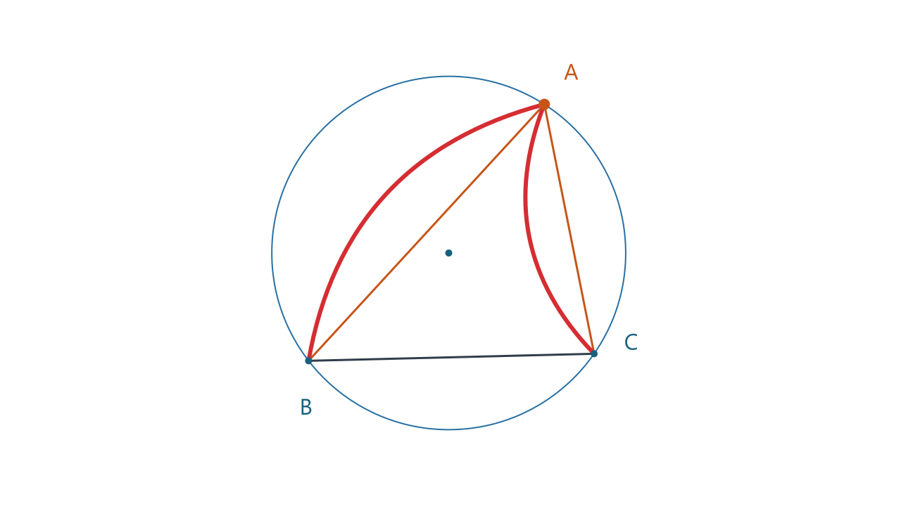
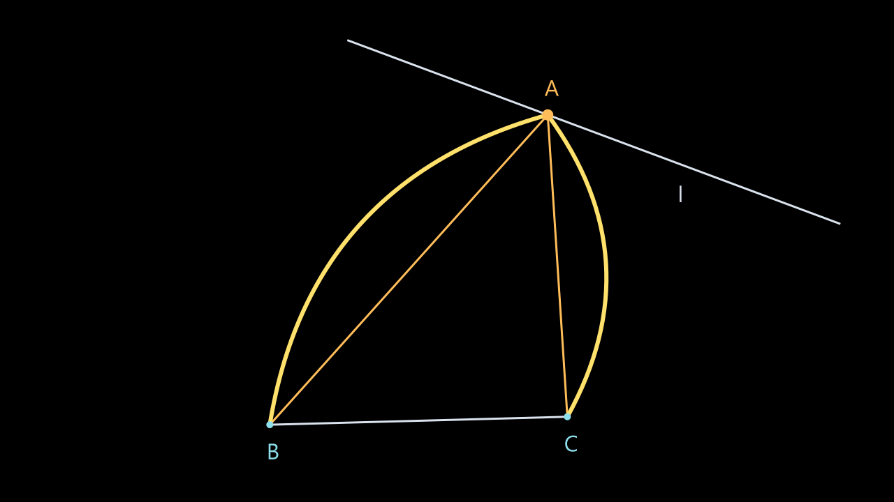

# GSP Motion CLI

对已解析的几何图形设置驱动点运动，按依赖关系逐帧重算，输出离线 HTML、PNG 帧序列和 MP4。

**Windows x64 · CLI + AI skill · MIT**。源码在 Git，完整运行库包在 [GitHub Releases](https://github.com/hjm-jim/gsp-motion/releases/latest)。

## 从 GitHub 安装

```powershell
git clone https://github.com/hjm-jim/gsp-motion.git
cd gsp-motion
powershell -NoProfile -ExecutionPolicy Bypass -File .\install.ps1
```

自动下载最新完整包、校验 SHA256 并安装 CLI 和 skill，无需管理员权限或预装 Node / FFmpeg。重新打开终端后：

```powershell
gsp-motion --version
gsp-motion doctor --json
gsp-motion inspect .\examples\demo1_triangle_circumcircle.gsp --json
gsp-motion render .\examples\demo1_triangle_circumcircle.gsp --point A --from -30 --to 30 --output .\circle.mp4 --json
```

AI 技能入口：[SKILL.md](skill/gsp-motion/SKILL.md)。[安装说明](INSTALL.md)包含无 Git 安装、源码安装、固定版本、自定义目录和排错。目前不提供 macOS / Linux / Windows ARM64 安装包。

当前版本 **0.7.1**。包含圆/直线区间运动、线/角高亮、三角形染色、显式列表隐藏/显示、静态演示与纯净 MP4 导出。0.7.1 补充可移植安装和发布，不改变 0.7.0 的几何表现。




0.7 将点名和原有线名调为默认 32px，通过 `--label-size 40` 或需求 JSON 的 `labelSize:40` 调整（12..96px）。自动避让几何线条、点、强调弧线和其他名称；先取样整个区间选择稳定偏移，再逐帧修正实际碰撞。图片、离线预览和视频共用布局。极密图形仍可能无空白，render 的 `labelCollisionSamples` 报告残余碰撞帧数。新增 line 的 `style:"arc"`，用亮色弓形弧线连接线段两端并动画绘出，保留原线；参数见 [EFFECTS.md](EFFECTS.md)。

**解析时自动生成图形信息**：inspect/render/animate 每次读取输入文件，会在输入旁生成或更新同主文件名 `.info.md`。例如 `C:\data\triangle.gsp` → `C:\data\triangle.info.md`；结果 JSON 的 `infoMd` 字段返回实际绝对路径。文件含标签→编号、构造说明、依赖、显隐、初始参数和输入字节 SHA-256；AI 先读此文件再设置目标，不把构造说明误作原始标签。不新增独立 info 命令，也不需要手写 Markdown。

输入目录不可写时可加 `--info-md <可写路径.md>`，或在需求 JSON 中设置 `infoMd`。默认同名辅助文件会更新。此功能也适用于已解析 JSON 输入。原 GSP 不会被修改，辅助信息不会进入视频。

显隐调用见 [VISIBILITY.md](VISIBILITY.md)，强调效果见 [EFFECTS.md](EFFECTS.md)。所有功能也可用源码 `node cli.cjs` 调用。

0.3 已提供纯净 MP4 直接导出、白底/黑底两套线点配色、需求 JSON、Windows 原生 exe 入口和 AI 技能。视频只显示几何图形及原有点名和线名，不含标题、说明、指标、时间、进度条或自动编号；`--labels false` 可去掉全部文字。

## 安装与直接调用

完整程序目录 `gsp-motion-0.7.1-win-x64`，可直接运行其中的 `gsp-motion.exe`。整包内置 Node、sharp、FFmpeg 及其 DLL，不依赖单独安装 Node、Python 或 FFmpeg；目标是 Windows x64，exe 启动器使用 Windows .NET Framework 4。

运行包中的 `install.ps1` 安装当前用户命令和技能，无需管理员权限。入口为 `%USERPROFILE%\.local\bin\gsp-motion.exe`，运行库安装在 `%LOCALAPPDATA%\Programs\GspMotion`；可从任意工作目录用参数数组直接启动 exe，无需 `cmd /c`。新开终端读取更新后的 PATH；固定绝对路径可立即使用。

```powershell
gsp-motion doctor --json
gsp-motion inspect 'C:\data\figure.gsp'
gsp-motion render 'C:\data\figure.gsp' --point A --from -30 --to 30 --background white --output 'C:\output\clip.mp4' --json
gsp-motion render --request 'C:\data\request.json' --json
```

`render` 在输出目录默认只写用户指定的 MP4，临时 PNG 自动清理；解析阶段在输入旁另写图形信息 MD。stdout 是一条 JSON 结果（含 infoMd）、stderr 是进度，成功退出码 0 且 `ok:true`，失败退出码 1 且 `ok:false`。可加 `--report report.json` 留存诊断；默认没有诊断面板进入画面。JSON 需求的相对路径以需求文件目录为基准，CLI 参数可覆盖需求文件。示例需求在 `examples/request-circle.json` 和 `examples/request-line.json`。

技能在 `skill/gsp-motion/SKILL.md`，默认安装到 `%USERPROFILE%\.codex\skills\gsp-motion\SKILL.md`；若设置 CODEX_HOME 则安装到其 skills 子目录。包含从 GSP 检查、自然语言需求转参数到直接导出纯净 MP4 的流程。AI 负责理解用户自然语言，CLI 接收明确参数/JSON。Python、Node 的无 shell 调用示例在 `skill/gsp-motion/references/api.md`。

## 单次运动与传统预览接口

支持圆与直线的区间单次运动。以 GSP 中的原始位置为参照，从一个区间端点单向走到另一个端点；不往返、不循环，结束后保留终态。对称区间的中间时刻经过原始位置。

- 圆示例：`output/demo.html`、`output/demo.mp4`，A 从原位置的 −30° 走到 +30°。
- 直线示例：`output-line/demo.html`、`output-line/demo.mp4`，A 沿原直线从 −50 走到 +50 个原图坐标单位。

两个示例均为 8 秒 / 30 fps / 1280×720，AB、AC 联动，B、C、BC 保持固定。

## 快速使用

以下是源代码调用方式；使用源代码需要 Node.js 20.9+。已打包 exe 无需此步骤。

```powershell
node cli.cjs inspect examples/demo1_triangle_circumcircle.gsp

# 生成离线 HTML，不需要 npm 安装依赖
node cli.cjs animate examples/demo1_triangle_circumcircle.gsp --point A --from -30 --to 30 --concyclic A,B,C --fixed 1 --out output

# 同时生成 PNG 序列和 MP4
node cli.cjs animate examples/demo1_triangle_circumcircle.gsp --point A --from -30 --to 30 --concyclic A,B,C --fixed 1 --duration 8 --fps 30 --width 1280 --height 720 --out output --frames --mp4

# 直线区间运动；正方向为父对象第一个定义点指向第二个定义点
node cli.cjs animate examples/demo1_triangle_line.gsp --point A --from -50 --to 50 --fixed B,C --out output-line --frames --mp4

# 对查看器导出的解析 JSON 使用同样的命令
node cli.cjs animate output/scene.json --point 5 --concyclic A,B,C --fixed 1 --out json-demo

node --test test.cjs
```

HTML 可直接双击打开，具有播放、暂停、重置、倍速、进度条和当前 SVG 帧下载。初始显示区间起点，点击播放后仅运行一次；到终点显示“已结束”并禁用播放按钮。可手动重置或向前拖动进度后再播放，不会自动重播。没有网络请求，不需要服务器；每次 CLI 输出都把几何数据和运行时代码嵌入 HTML。修改源码后需要重新运行 animate 才会更新已生成的 HTML。

源码模式下，PNG 导出需要 `sharp`（`npm ci` 安装），MP4 需要本机 FFmpeg。完整 Release 包已包含运行库。高级用户也可显式指定：

```powershell
node cli.cjs animate examples/demo1_triangle_circumcircle.gsp --point A --out output --mp4 --ffmpeg "C:\ffmpeg\bin\ffmpeg.exe" --sharp-module "C:\path\to\node_modules\sharp"
```

## 参数

| 参数 | 用途 | 默认值 |
|---|---|---|
| `--point` | 驱动点标签或编号；必须是已有圆或直线型对象上的有效约束点 | A |
| `--background` | white / black，两套背景与线点配色 | white |
| `--labels` | true / false，仅显示原图实际存在的点名和线名，不生成编号 | true |
| `--label-size` | 名称字号，12..96px；JSON 字段为 labelSize | 32 |
| `--from` / `--to` | 相对 GSP 原始位置的起止偏移；圆为角度，直线为沿父对象方向的有符号距离 | 圆 −30 / +30；直线 −50 / +50 |
| `--duration` / `--fps` | 总时长与视频取样帧率 | 8 秒 / 30 |
| `--width` / `--height` | SVG、PNG、视频尺寸，必须为偶数 | 1280 / 720 |
| `--turns` | 兼容整周运动的显式选项；仅限圆，与 from/to 互斥，仍只播放一次 | 不启用 |
| `--direction` | 仅限圆：`cw` 为偏移角正方向顺时针，`ccw` 为逆时针；采用 SVG 屏幕坐标 | cw |
| `--concyclic` | 用逗号分隔的点标签/编号，至少三个，观察到驱动点父圆的距离误差 | 无 |
| `--fixed` | 用逗号分隔的点标签/编号，观察相对初始帧位移 | 无 |
| `--perpendicular` | 两个直线型对象编号，以逗号分隔，观察归一化点积绝对值 | 无 |
| `--out` | 输出目录；同名输出会更新 | output |
| `--frames` | 导出 `frames/frame-000000.png` 等 PNG | 关闭 |
| `--mp4` | 导出 H.264 / yuv420p 视频，自动导出 PNG | 关闭 |

参数名前统一使用 `--`，负数值可直接写为 `--from -50`。from/to 是相对原始位置的偏移，既不是绝对坐标，也不是直线参数 t。多个观察点可写为 `--fixed 1,B,C`。数值误差沿用原始图形坐标单位，归一化点积没有单位。

若 from 大于 to，则单向从较大偏移走到较小偏移；不会形成往返。直线的正方向由父对象两定义点的顺序决定，不保证在屏幕上总是朝右。对线段/射线上的点，也按距离转换为原始约束参数，但区间超出线段端点或射线起点时会报错，不自动外延。

导出 N=max(2,ceil(duration×fps)) 帧，时间轴取样为 `duration*i/(N-1)`，因此第一帧和最后一帧精确包含区间两端，MP4 末帧停在终点。编码播放时长为 N/fps；默认 240 帧仍为 8 秒。HTML 与导出共用帧函数，视频帧索引需按该公式映射至逻辑时间。PNG 保留供剪辑使用；重复运行不会删除已有帧，多余旧帧不会被当前 MP4 编码，导入剪辑软件时请按 report.json 的 frames 数选取或使用新的输出目录。

## 文件与接口

- `geometry-core.cjs`：从现有查看器提取的独立几何核心快照，增加失效点保护、依赖点缓存优先级修正和固定交点分支。原查看器文件不修改。
- `motion.cjs`：拓扑排序、确定时间取样、数值观察和 SVG 绘制。
- `label-layout.cjs`：点名/线名的全区间偏移规划与逐帧几何避让。
- `cli.cjs`：文件加载、HTML 生成、PNG 与视频导出。
- `examples/`：用户提供的真实 GSP 样例副本。
- `output/scene.json`：原始解析结果，可作为 CLI 后续输入。
- `output/model.json`：整理后的依赖图、运动参数及固定镜头范围。
- `output/report.json`：帧数、误差和退化/失效采样统计。
- `FEASIBILITY.md`：依赖重算和支持范围说明。

JavaScript 中可调用 `Motion.prepare(scene, options)`、`Motion.frame(model, seconds)`、`Motion.svg(model, seconds)`。HTML 暴露 `window.gspMotion.seek(seconds)`、`frame(seconds)`、`svg(seconds)`，便于其他工具按时间重用。

数值观测不等同于数学证明。圆默认显示在线圆约束误差，直线默认显示到父直线的距离误差；`--concyclic` 仍仅适用于圆约束驱动点。更多边界见 FEASIBILITY.md。

可选浏览器集成验证：安装 Playwright 并具备 Microsoft Edge 后运行 `node verify-browser.cjs`。本机已使用 Codex 附带的 Playwright 执行该验证。

源码测试入口：`npm ci` 后运行 `npm test`；GitHub Actions 对 Node 20 / 24 运行检查。解析测试会在样例旁写辅助 MD，这些文件已忽略，不进入 Git。打包脚本从本项目 node_modules 复制 sharp 和依赖，从指定 FFmpeg 目录复制 exe/DLL，并用 Windows C# 编译器生成启动器；manifest.json 记录实际版本。完整步骤见 [INSTALL.md](INSTALL.md)。浏览器视觉检查需额外安装 Playwright 和 Edge。

项目代码使用 [MIT](LICENSE)；第三方运行库的许可证、版本和源码入口见 [THIRD_PARTY.md](THIRD_PARTY.md)。
