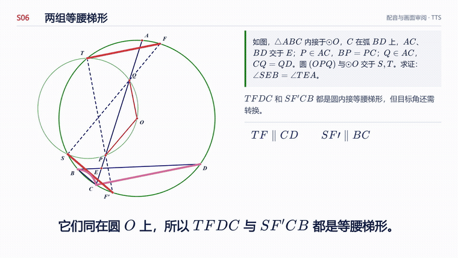

# GSP Motion CLI / 几何画板动画工具

[中文](#中文) · [English](#english) · [安装说明 / Installation](INSTALL.md) · [AI Skill](skill/gsp-motion/SKILL.md)

## 中文

**把复杂几何题的教案，变成直观的几何画板演示视频。** 数学老师可以沿用已经画好的 GSP 图形，指定讲解顺序、点的运动区间、初始显示、显隐和强调效果，直接导出 MP4，减少为每道题反复绘图、录屏和手动剪辑的工作。CLI 负责几何依赖重算与画面渲染，AI skill 帮助把自然语言讲解需求转成明确的调用参数。

### 效果演示

下面的动图可在 README 中直接播放预览。点击它可观看完整的[《谜之竞赛—变相同一法第一讲》演示视频](https://github.com/hjm-jim/gsp-motion/releases/download/v0.11.1/geometry-lesson-demo.mp4)（约 5 分钟，含讲解与配音）。这是结合本工具输出图形与后期讲解制作的**成片示例**；CLI 单独导出的 MP4 是无解说文字、无音轨的纯净几何画面。

[](https://github.com/hjm-jim/gsp-motion/releases/download/v0.11.1/geometry-lesson-demo.mp4)

### 能做什么

- 读取 GSP，生成带对象编号、标签、依赖和样式的 `.info.md`，方便 AI 准确指认图形元素。
- 让圆上或直线上的一个点在指定区间**单向运动一次**，逐帧重算相关几何对象。
- 设置讲解的初始画面，按时间显示或隐藏点、线和圆；为可见对象添加点、线、圆、角及三角形的动画强调。
- 继承 GSP 的颜色、虚实线、粗细与点大小；提供白底和黑底；自动安排点名、线名与圆名，支持下标。
- 导出 1920×1080（可调整）的纯净 H.264 MP4，也支持离线 HTML 和 PNG 帧。

### 安装与调用

支持 **Windows x64**。以下命令安装最新正式版 CLI 与 AI skill，不需要管理员权限，也不需要预装 Node、Python 或 FFmpeg。包从 GitHub Release 下载并校验 SHA-256。

```powershell
git clone https://github.com/hjm-jim/gsp-motion.git
cd gsp-motion
powershell -NoProfile -ExecutionPolicy Bypass -File .\install.ps1
gsp-motion --version
gsp-motion doctor --json
```

检查图形并导出视频：

```powershell
gsp-motion inspect .\examples\demo1_triangle_circumcircle.gsp --json
gsp-motion render .\examples\demo1_triangle_circumcircle.gsp --point A --from -30 --to 30 --output .\circle.mp4 --json
gsp-motion render --request .\examples\request-circle.json --json
```

`inspect`、`render` 和 `animate` 会在 GSP 旁生成同名 `.info.md`。需求 JSON 和显隐、强调语义见 [AI skill](skill/gsp-motion/SKILL.md)、[效果说明](EFFECTS.md)及[显隐说明](VISIBILITY.md)。[安装说明](INSTALL.md)包含固定版本、无 Git 安装与源码构建。历史版本的详细中文说明保存在[此处](docs/README-legacy.zh-CN.md)。

## English

**Turn a difficult geometry lesson plan into a clear, dynamic Sketchpad demonstration.** Math teachers can reuse a GSP construction, specify the explanation sequence and geometric motion, and export a video without redrawing the figure, recording the screen, or manually editing each step. The CLI recomputes dependent objects frame by frame; the AI skill maps natural language instructions to precise CLI requests.

### Demo

The animated preview plays directly in this README. Click it to watch the [full geometry lesson video](https://github.com/hjm-jim/gsp-motion/releases/download/v0.11.1/geometry-lesson-demo.mp4) (about five minutes, with narration). This is a **finished lesson** assembled from geometry visuals and additional explanation. MP4 files exported directly by the CLI contain only the geometry, its original labels, and no narration or audio.

[](https://github.com/hjm-jim/gsp-motion/releases/download/v0.11.1/geometry-lesson-demo.mp4)

### Features

- Parse GSP constructions and generate a companion `.info.md` with object IDs, labels, dependencies, and styles for reliable AI selection.
- Move one point along a circle or line through a specified interval **once**, updating the dependent construction on every frame.
- Set the initial visible figure, show or hide objects over time, and animate emphasis for visible points, lines, circles, angles, and triangles.
- Preserve original GSP colors, dash patterns, stroke widths, and point sizes; choose white or black backgrounds; lay out point, line, and circle labels, including subscripts.
- Export clean H.264 MP4 at 1920×1080 by default (configurable), plus offline HTML or PNG frames.

### Install and run

**Windows x64** is supported. The installer downloads the latest release, verifies its SHA-256 checksum, and installs the CLI and AI skill for the current user. No administrator access or preinstalled Node, Python, or FFmpeg is required.

```powershell
git clone https://github.com/hjm-jim/gsp-motion.git
cd gsp-motion
powershell -NoProfile -ExecutionPolicy Bypass -File .\install.ps1
gsp-motion --version
gsp-motion doctor --json
```

```powershell
gsp-motion inspect .\examples\demo1_triangle_circumcircle.gsp --json
gsp-motion render .\examples\demo1_triangle_circumcircle.gsp --point A --from -30 --to 30 --output .\circle.mp4 --json
gsp-motion render --request .\examples\request-circle.json --json
```

`inspect`, `render`, and `animate` create a sibling `.info.md` for the input GSP. See the [AI skill](skill/gsp-motion/SKILL.md) for the request format and precise meanings of highlight, show/hide, and initial visibility. See [installation options](INSTALL.md), [effects](EFFECTS.md), and [visibility](VISIBILITY.md) for details. The program is MIT licensed; platform and bundled dependency notices are in [THIRD_PARTY.md](THIRD_PARTY.md).
